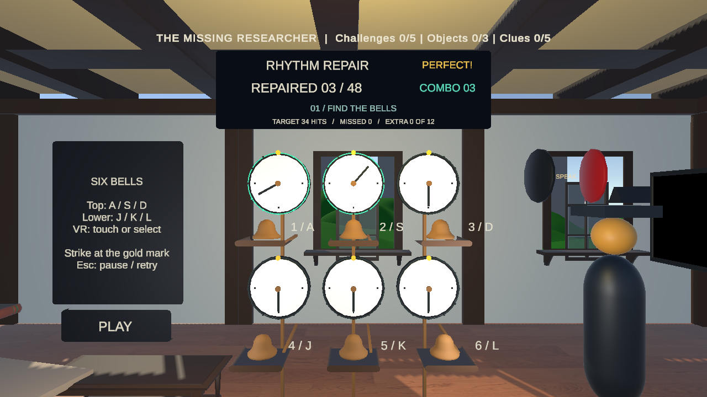
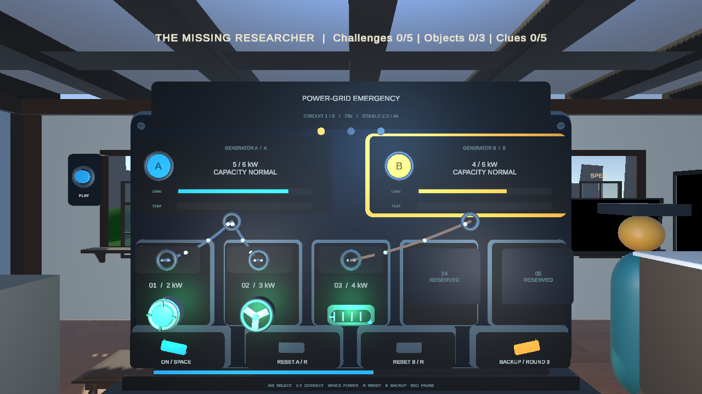
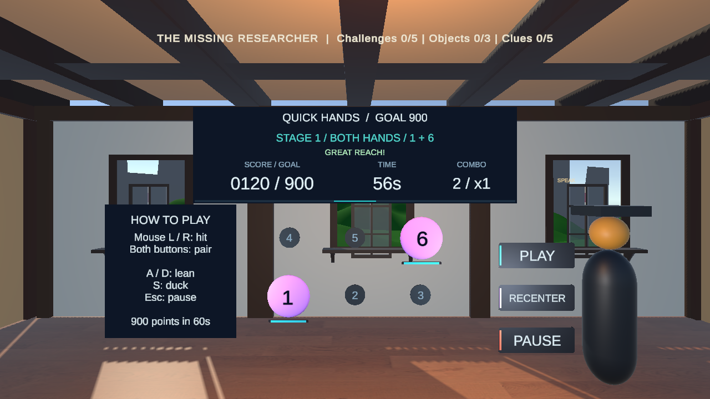

# The Forgotten Village：近期開發與交接紀錄

紀錄日期：2026-11-11（Asia/Taipei）；Unity 6000.0.80f1。

前一版功能基準：`ebf8091`。本次以快手工坊取代造橋試車，修鐘擴充為六鐘版，並依照飛機／桌球的介面重新整理兩款遊戲。最新驗證與提交範圍見第 4、6 節。

近期開發主要把房子裡原本偏文字、計算或面板操作的解題流程，改成可以直接操作、有動畫回饋、能失敗重試的小遊戲。這次將木匠屋的造橋玩法替換成以身體動作、反應與連擊為主的「快手工坊」，並把節奏修鐘從三個鐘擴充成六個鐘與 48 音符。先前的電網搶修及工作臺美術優化也保留在這份交接紀錄中。

## 1. 房子目前的狀態

| 房子 | 目前玩法 | 本輪工作 |
| --- | --- | --- |
| 長老屋 Elder | 桌球 | 原有遊戲，本輪保留 |
| 煉金術師屋 Alchemist | 飛機夢境 | 原有遊戲，本輪保留 |
| 木匠屋 Carpenter | Quick Hands Workshop：快手工坊 | 取代造橋，新增 60 秒伸手擊中、雙手配合與身體閃避挑戰 |
| 技師屋 Technician | Power-grid emergency：電網搶修 | 新增三關供電挑戰，並完成視覺優化 |
| 鐘錶匠屋 Clockmaker | Rhythm Repair：六鐘節奏修鐘 | 擴充為兩排六鐘、48 音符，支援手部接觸敲鐘 |
| 廢棄屋 Abandoned House | 最終證據調查與控制臺 | 保留原有結局條件；測試輔助流程配合新遊戲更新 |

## 2. 新增及改善的遊戲

### 鐘錶匠：Rhythm Repair／節奏修鐘

玩家觀察兩排共六個鐘面的指針，在接近金色標記時敲擊對應的鐘，透過節奏操作修復機構。

- 加入四拍倒數、三段逐漸變化的譜面，共 48 個音符；由熟悉上下兩排、交替敲擊，進入更快的結尾，約 42 秒。
- 加入 Perfect／Good 判定、連擊、失誤與過關結果。通關需要至少命中 34 個音符，且額外敲擊不超過 12 次。
- 支援暫停、重新開始、離開及輸入延遲校正；暫停會凍結音樂時間。
- 完成後解鎖角色記憶，再透過原有的實體時鐘辨識流程取得第 5 條線索。
- 最新視覺採用開放式六鐘遊玩區：鐘面由獨立細支架支撐，使用素色奶油白鐘面、深色指針與金色判定標記，搭配小型霧面古銅鐘鈴；移除包覆鐘面的櫃體、橫跨鐘面的層架與大量金色裝飾。上方大型深藍資訊板、左側獨立操作說明與下方過關目標，沿用飛機／桌球的清楚配置；保留接近提示點、敲鐘動畫，以及六個不同音色與節拍提示。

桌面操作：上排 `A / S / D`，下排 `J / K / L`；`Esc` 開啟暫停選單。遊戲中 J 專門敲第 4 個鐘，結束後恢復日誌快捷鍵。VR 可以用實際追蹤到的手把位置碰鐘，或使用控制器選取；停留在鐘內不會連續刷取命中。

詳細說明：[CLOCK_RHYTHM.md](CLOCK_RHYTHM.md)

### 技師：Power-grid emergency／電網搶修

玩家選擇發電機，將工作坊機器分配到不同電源，觀察負載與溫度，在限時內恢復穩定供電。

- 加入 A／B 發電機、機器接線、容量與負載顯示，以及可見的連接電纜。
- 過載會逐漸累積熱量並造成斷路器跳脫；玩家需要先調整負載，再安全復歸。
- 共三關，逐步加入更多機器、預先跳脫的斷路器及備援電力需求。
- 每關限時 75 秒，所有必要機器需連續安全供電 4 秒才算完成。
- 支援失敗重試、重開與暫停；暫停會凍結熱量與倒數。
- 完成後恢復角色記憶與診斷紀錄，再透過原有的手機辨識流程取得第 4 條線索。原本結局需要的 RUN／STOP 診斷證據仍會產生並保存。
- 視覺增加金屬與琺瑯機櫃、負載／溫度儀表、電源選取框、不同機器造型、運轉動畫及電纜上的流動光點。

桌面操作：`A / S` 選發電機、`1–5` 接線／解除連接、`Space` 切換主電源、`R` 復歸所選斷路器、`B` 切換備援。也支援滑鼠點擊與 VR 面板選取；既有 USB 按鈕接到主電源切換功能。

詳細說明：[POWER_GRID.md](POWER_GRID.md)

### 木匠：Quick Hands Workshop／快手工坊

玩家在 60 秒內伸手擊中亮起的目標、用雙手同時完成成對目標，再依提示側身或降低頭部躲開木板，透過反應和協調挑戰分數。這是參考 Active Arcade 互動節奏所設計的現有 VR 頭盔／手把遊戲。

- 三秒準備倒數後開始；60 秒結束時達到 900 分才通關，提早達標仍可繼續挑戰高分。
- 每次重試產生新的隨機組合；每 20 秒進入下一階段，目標出現時間逐漸縮短。
- 單一目標可使用任一隻手；雙手目標需要不同手在 0.4 秒內碰到兩個不同目標。
- VR 以手把實際進入目標範圍判定；把手停在目標裡不會重複得分。
- 左移、右移、蹲低都有預告；維持正確動作一小段時間才完成閃避，無須跳躍。
- 連續成功提高倍率，最高 x4；失誤中斷連擊，撞到障礙會扣分。完成一局後保存個人最高分。
- 開始時依頭部中立位置調整目標高度，可站著或坐著玩；FIT REACH／暫停選單可重新置中。頭部或雙手都失去追蹤超過 0.75 秒會自動暫停。
- 最新視覺改為開放遊玩區，使用六個大型霧面目標與低調的待機標記；每個亮起的目標附有縮減時間條，方便判斷剩餘反應時間。上方大型深藍 HUD 持續顯示分數、時間、連擊與 900 分目標，左側獨立顯示操作方式；移除包覆式機臺、木偶表情與亮金外框，讓遊玩目標成為畫面重點。保留左右手標記與站位墊。
- 暫停凍結時間、目標與動畫；結束活動會恢復鏡頭、游標與移動控制。
- 通關後解鎖角色記憶，再透過原有的實體滑鼠辨識流程取得第 3 條線索。

桌面操作：滑鼠左／右鍵對應左右手，對準亮起的目標點擊；成對目標可對準其中一個，同時按住兩個滑鼠鍵。`A / D` 側移、`S` 蹲低、`Esc` 暫停。VR 使用雙手接觸與頭部位置判定動作。

詳細說明：[ACTIVE_WORKSHOP.md](ACTIVE_WORKSHOP.md)。先前造橋功能與測試保留於 [BRIDGE_DELIVERY.md](BRIDGE_DELIVERY.md)，作為已被替換版本的歷史紀錄。

## 3. 與原專案的整合

- 三款遊戲皆支援桌面與既有 XR 互動路徑，沿用共用玩家 Rig 與場景切換服務。
- 更新各房子的對話、日誌提示、線索領取條件，以及離開／重進房間的狀態處理。
- 存檔結構更新至 schema 8，新增快手工坊勝利與最高分，保留記憶狀態及符合條件的舊版已取得線索；未完整取得線索的橋梁進度需要玩新版活動。
- 防止重複領取線索，也封住舊面板完成路徑直接繞過新遊戲的情況。
- 場景和 Prefab 已保存新設備與互動綁定；一般村莊重建工具也會安裝新版遊戲。
- 新增共用 `WorkshopArt` 編輯器工具，產生並保存工作臺的圓角模型與材質，供這些房子的設備使用。
- 改善桌面俯視工作臺時的 UI 朝向，讓暫停與結果面板保持可讀；VR 保留頭部追蹤視角。

主要程式位置如下，路徑以 `Assets/TheForgottenVillage/` 為起點：

| 位置 | 用途 |
| --- | --- |
| `Scripts/ClockRhythm/` | 節奏譜面、判定、音效、輸入、遊戲狀態與房子流程 |
| `Scripts/PowerGrid/` | 供電規則、接線、過載、控制、機器回饋與房子流程 |
| `Scripts/ActiveWorkshop/` | 隨機挑戰、手部命中、雙手配合、頭部閃避、校正、分數與房子流程 |
| `Scripts/BridgeDelivery/` | 已退役橋梁活動的歷史程式，正常村莊流程使用快手工坊 |
| `Scripts/Core/VillageGame.cs`、`VillageSave.cs` | 進度、獎勵、存檔與版本相容處理 |
| `Scripts/UI/VillageUI.cs` | 活動 UI、暫停與桌面面板位置 |
| `Scripts/Editor/` | 各遊戲建置、整合檢查與 Play Mode 自動化；共用 `WorkshopArt.cs` |
| `Tests/Editor/` | 規則、存檔與進度回歸測試 |
| `Scenes/`、`Prefabs/`、`Materials/`、`Meshes/` | 已保存的房子場景、設備與視覺資產 |

## 4. 已完成的驗證

### 本次快手工坊與六鐘版交付結果

| 驗證項目 | 結果與範圍 |
| --- | --- |
| Runtime／Editor 編譯 | 最終原始碼通過；課程資源庫仍有既有 API 過時警告 |
| Edit Mode 單元測試 | **104 項通過，0 失敗、0 略過**；包含新舊進度相容、雙手判定、閃避、計分及六鐘譜面等回歸 |
| 六屋靜態檢查 | 保留六個來源根物件；無遺失腳本、重複啟用鏡頭／Audio Listener；木匠屋已移除橋活動，六鐘綁定完整 |
| 快手工坊完整流程 | 實際跑完 60 秒失敗及成功；滑鼠／雙鍵／A D S、共用追蹤接觸路徑、暫停、重試、最高分、記憶、模擬滑鼠證據、唯一線索、磁碟存檔與重進房間通過 |
| 六鐘完整流程 | 真實時間 48 音符失敗／成功；六個按鍵含 J、XR 選取與手部接觸入口、暫停、記憶、模擬時鐘證據、線索及存檔通過 |
| 最終介面短流程 | 開放遊戲區、大字深色 HUD、單／雙目標／閃避提示、六鐘選取射線、暫停及控制還原通過；最終截圖已目視檢查 |

完整遊玩測試負責規則與進度；介面重做後另跑最終畫面短流程及選取檢查。上述流程未捕捉到 Runtime 錯誤。全村結局流程及 VR／Pi 實機驗收範圍見第 5 節；以下為前一版歷史結果。

### 前一版驗證歷史（`ebf8091` 及之前）

| 驗證項目 | 結果與範圍 |
| --- | --- |
| Runtime／Editor 編譯 | 前一版造橋交付通過；先前兩款遊戲與美術優化階段也有通過紀錄 |
| Edit Mode 單元測試 | 前一版共 66 項通過、0 失敗、0 略過；此數字是當時整套單元回歸總數 |
| 六間房子靜態整合檢查 | 場景參照、來源房間根物件、遺失腳本及重複啟用鏡頭／Audio Listener 等檢查通過 |
| 三鐘版節奏修鐘 Play Mode | 完整失敗／成功、鍵盤輸入、暫停、重試、記憶、模擬實物證據、存檔與重進房間通過；美術優化後亦有完整流程紀錄 |
| 電網搶修 Play Mode | 過載、跳脫、復歸、完整 75 秒逾時、重試、三關成功、鍵鼠與共用 XR 回呼、模擬相機／USB、線索與存檔流程通過；美術優化後亦有完整流程紀錄 |
| 造橋試車 Play Mode | 實際注入滑鼠拖放與 Q／E／Space、XR 抓取回呼、空橋掉落、短板／弱橋失敗、三次真實物理通行、支撐安裝、保留配置重試、暫停、線索、磁碟存檔與重進房間通過 |
| 視覺與選取 | 已檢視遊戲截圖；鐘鈴、電網面板與造橋控制的選取射線通過遮擋檢查 |

歷史驗證中的上述 Play Mode 測試未捕捉到 Runtime 錯誤。XR 回呼測試代表程式互動路徑通過，實際配戴手感仍需裝置驗收。

證據入口：

- [整合測試紀錄](Verification/house-playtest-results.txt)：由上往下為最新項目；下方 legacy 區段屬歷史結果。
- [本次 104 項單元測試](Verification/active-workshop-editmode.txt)、[快手工坊完整流程](Verification/active-workshop-playmode.txt)及[最終介面檢查](Verification/active-games-presentation.txt)。
- [歷史造橋單元測試摘要](Verification/bridge-delivery-editmode.txt)及 [NUnit XML](Verification/bridge-delivery-editmode.xml)。
- [歷史造橋完整流程結果](Verification/bridge-delivery-playmode.txt)。
- [節奏修鐘流程結果](Verification/clock-rhythm-playmode.txt)以本次最終報告為準；[電網搶修流程結果](Verification/power-grid-playmode.txt)保留先前交付證據。
- [較完整的英文開發歷史](DEVELOPMENT_RECORD.txt)。

## 5. Partner 接手時需要確認的項目

1. **VR 實機**：Quest／控制器的可觸及範圍、快手工坊雙手接觸與閃避、校正與追蹤遺失恢復、六鐘上下排的手感、震動、UI 閱讀，以及修鐘音訊延遲與節奏感。
2. **實體設備**：Pi 相機對時鐘、手機、滑鼠的辨識；USB／Arduino 接線與實體按鈕。自動化中的相機與部分硬體證據使用模擬，尚未代表實機通過。
3. **完整結局回歸**：全村結局測試輔助流程已配合新玩法更新；這一輪尚未重新跑完「所有房子 → 全部線索 → 最終調查／結局」的完整 Runtime 流程。
4. **真人遊玩調整**：找未參與開發的人試玩，確認提示是否清楚、六鐘譜面與節奏判定、電網倒數、快手工坊反應時間與 900 分門檻是否合適。

快速查看方式：用 Unity 6000.0.80f1 開啟 `Assets/Scenes/rpgpp_lt_scene_1.0.unity`，進入 Play Mode，完成長老開場對話後前往要試玩的房子。各房可透過 NPC 對話或 PLAY 控制開始。

## 6. 提交紀錄

- 節奏修鐘：30 筆依序且含實際變更的本機提交，最後為 `e82e45c`。
- 電網搶修：33 筆依序且含實際變更的本機提交，最後為 `3670b55`。
- 工作臺視覺優化：主要資產／程式變更收於 `ce9955d`；交付紀錄補充為 `12bb733`。
- 木匠造橋試車：`ebf8091` — `Create Carpenter Bridge Delivery with interactive timber and physical cart trials`。

以上為先前功能交付時的本機 Git 歷史。

本次提交主題：`Replace Carpenter bridge with motion arcade and expand rhythm repair to six bells`。內容包含兩款遊戲、場景／Prefab、視覺資產、存檔相容、測試證據與本交接紀錄。完整雜湊與遠端同步狀態可由 `main` 的 Git 紀錄查核。

## 7. 遊戲畫面

### 六鐘節奏修鐘

### 電網搶修

### 快手工坊

