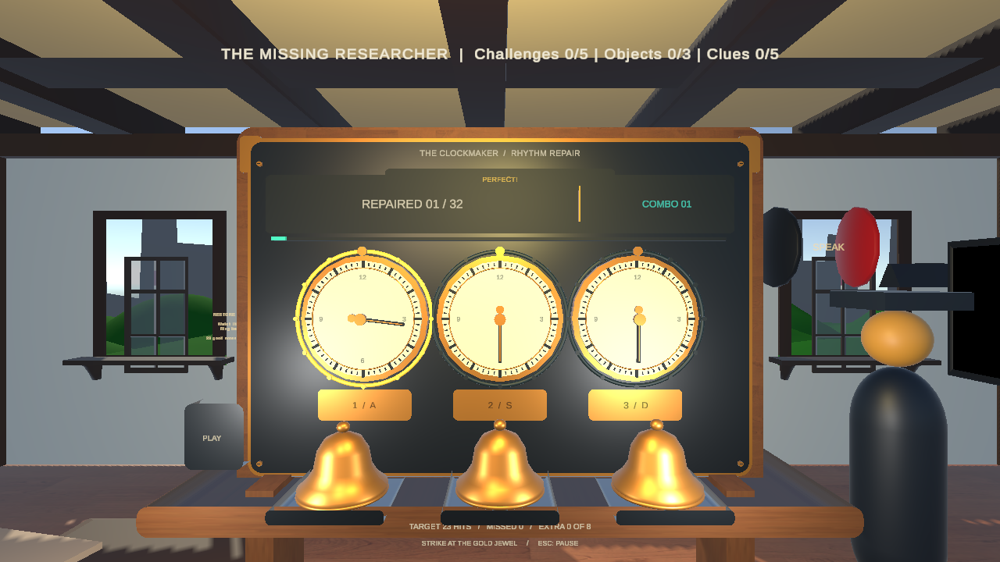
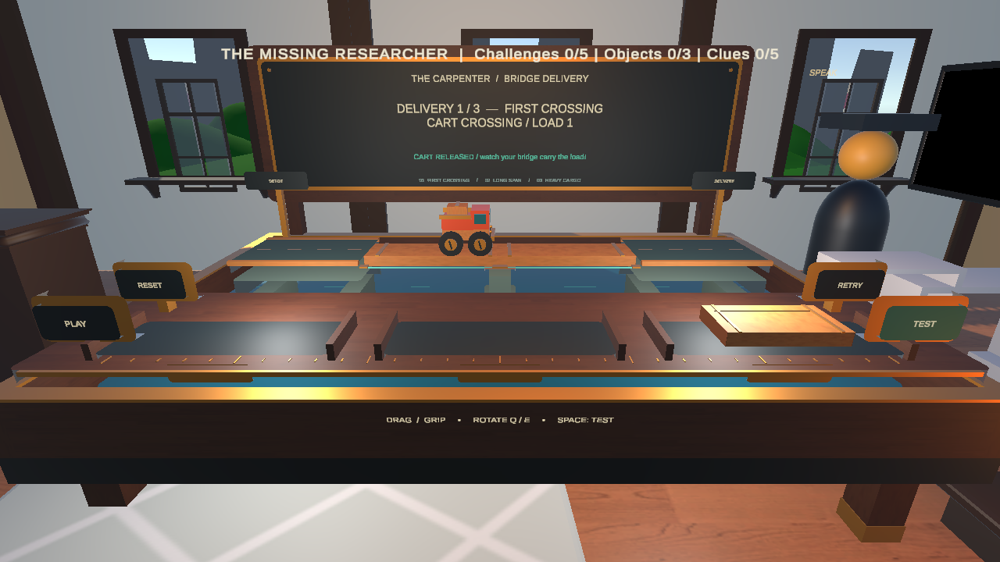

# The Forgotten Village：近期開發與交接紀錄

紀錄日期：2026-11-11（Asia/Taipei）  
適用版本：Unity 6000.0.80f1  
遊戲功能基準提交：`ebf8091`

這一輪主要把房子裡原本偏文字、計算或面板操作的解題流程，改成可以直接操作、有動畫回饋、能失敗重試的小遊戲。已完成鐘錶匠、技師與木匠三間房子的玩法，以及鐘錶匠和技師工作臺的視覺優化。新遊戲已接回角色記憶、實物辨識、線索與存檔流程。

## 1. 房子目前的狀態

| 房子 | 目前玩法 | 本輪工作 |
| --- | --- | --- |
| 長老屋 Elder | 桌球 | 原有遊戲，本輪保留 |
| 煉金術師屋 Alchemist | 飛機夢境 | 原有遊戲，本輪保留 |
| 木匠屋 Carpenter | Bridge Delivery：造橋試車 | 新增三關互動搭橋與物理試車 |
| 技師屋 Technician | Power-grid emergency：電網搶修 | 新增三關供電挑戰，並完成視覺優化 |
| 鐘錶匠屋 Clockmaker | Rhythm Repair：節奏修鐘 | 新增節奏遊戲，並完成視覺與音效優化 |
| 廢棄屋 Abandoned House | 最終證據調查與控制臺 | 保留原有結局條件；測試輔助流程配合新遊戲更新 |

## 2. 新增及改善的遊戲

### 鐘錶匠：Rhythm Repair／節奏修鐘

玩家觀察三個鐘面的指針，在接近金色標記時敲擊對應的鐘，透過節奏操作修復機構。

- 加入四拍倒數、三段逐漸變化的譜面，共 32 個音符。
- 加入 Perfect／Good 判定、連擊、失誤與過關結果。通關需要至少命中 23 個音符，且額外敲擊不超過 8 次。
- 支援暫停、重新開始、離開及輸入延遲校正；暫停會凍結音樂時間。
- 完成後解鎖角色記憶，再透過原有的實體時鐘辨識流程取得第 5 條線索。
- 視覺增加木質與黃銅鐘櫃、白色鐘面、刻度、音符接近提示燈、敲鐘動畫、分數與連擊顯示；音效加入不同鐘聲與節拍提示。

桌面操作：`A / S / D` 對應三個鐘；`Esc` 開啟暫停選單。VR 使用控制器選取鐘鈴。

詳細說明：[CLOCK_RHYTHM.md](CLOCK_RHYTHM.md)

### 技師：Power-grid emergency／電網搶修

玩家選擇發電機，將工作坊機器分配到不同電源，觀察負載與溫度，在限時內恢復穩定供電。

- 加入 A／B 發電機、機器接線、容量與負載顯示，以及可見的連接電纜。
- 過載會逐漸累積熱量並造成斷路器跳脫；玩家需要先調整負載，再安全復歸。
- 共三關，逐步加入更多機器、預先跳脫的斷路器及備援電力需求。
- 每關限時 75 秒，所有必要機器需連續安全供電 4 秒才算完成。
- 支援失敗重試、重開與暫停；暫停會凍結熱量與倒數。
- 完成後恢復角色記憶與診斷紀錄，再透過原有的手機辨識流程取得第 4 條線索。原本結局需要的 RUN／STOP 診斷證據仍會產生並保存。
- 視覺增加金屬與琺瑯機櫃、負載／溫度儀表、電源選取框、不同機器造型、運轉動畫及電纜上的流動光點。

桌面操作：`A / S` 選發電機、`1–5` 接線／解除連接、`Space` 切換主電源、`R` 復歸所選斷路器、`B` 切換備援。也支援滑鼠點擊與 VR 面板選取；既有 USB 按鈕接到主電源切換功能。

詳細說明：[POWER_GRID.md](POWER_GRID.md)

### 木匠：Bridge Delivery／造橋試車

玩家直接抓取、旋轉與放置木板，搭出一座能讓貨車通過的橋，接著啟動貨車測試自己的設計。

- 第一關練習基本搭橋；第二關擴大跨度，要求選對長木板；第三關增加貨物重量，需要加裝支撐。
- 木板可抓取、旋轉，靠近正確位置放下後固定；方向錯誤的木板無法固定。
- 貨車使用實際 Rigidbody 物理行駛。橋面不足會掉落，短木板或承重不足的木板會在受載後斷裂。
- 勝利必須由貨車實際抵達對岸判定，單純把材料放好不會過關。
- 試車失敗會保留配置；按 RETRY 修復掉落材料後，可直接調整橋梁再試。
- 桌面玩家可將支撐放到可見橋板上，系統會安裝到橋下，方便操作被橋面遮住的位置。
- 加入木質／黃銅工作桌、河道、河岸、材料架、貨車模型、狀態板，以及 PLAY／TEST／RETRY／RESET 實體控制。
- 暫停會凍結貨車及掉落木板；結束活動會恢復鏡頭、游標與移動控制。
- 三次配送完成後解鎖角色記憶，再透過原有的實體滑鼠辨識流程取得第 3 條線索。

桌面操作：滑鼠左鍵抓取／拖曳／放下、`Q / E` 旋轉、`Space` 試車、`R` 歸還手上材料或重置搭建。VR 使用 XR 抓取與選取。

詳細說明：[BRIDGE_DELIVERY.md](BRIDGE_DELIVERY.md)

## 3. 與原專案的整合

- 三款遊戲皆支援桌面與既有 XR 互動路徑，沿用共用玩家 Rig 與場景切換服務。
- 更新各房子的對話、日誌提示、線索領取條件，以及離開／重進房間的狀態處理。
- 存檔結構逐步更新至 schema 7，記錄遊戲勝利及記憶恢復狀態，保留符合條件的舊版已取得線索；未完成的舊計算題不會自動算成新遊戲勝利。
- 防止重複領取線索，也封住舊面板完成路徑直接繞過新遊戲的情況。
- 場景和 Prefab 已保存新設備與互動綁定；一般村莊重建工具也會安裝新版遊戲。
- 新增共用 `WorkshopArt` 編輯器工具，產生並保存工作臺的圓角模型與材質，供這些房子的設備使用。
- 改善桌面俯視工作臺時的 UI 朝向，讓暫停與結果面板保持可讀；VR 保留頭部追蹤視角。

主要程式位置如下，路徑以 `Assets/TheForgottenVillage/` 為起點：

| 位置 | 用途 |
| --- | --- |
| `Scripts/ClockRhythm/` | 節奏譜面、判定、音效、輸入、遊戲狀態與房子流程 |
| `Scripts/PowerGrid/` | 供電規則、接線、過載、控制、機器回饋與房子流程 |
| `Scripts/BridgeDelivery/` | 木板抓取、固定點、貨車物理、支撐、關卡與房子流程 |
| `Scripts/Core/VillageGame.cs`、`VillageSave.cs` | 進度、獎勵、存檔與版本相容處理 |
| `Scripts/UI/VillageUI.cs` | 活動 UI、暫停與桌面面板位置 |
| `Scripts/Editor/` | 各遊戲建置、整合檢查與 Play Mode 自動化；共用 `WorkshopArt.cs` |
| `Tests/Editor/` | 規則、存檔與進度回歸測試 |
| `Scenes/`、`Prefabs/`、`Materials/`、`Meshes/` | 已保存的房子場景、設備與視覺資產 |

## 4. 已完成的驗證

以下為各階段已留存的測試結果。本紀錄整理既有證據，沒有另外重跑遊戲測試。

| 驗證項目 | 結果與範圍 |
| --- | --- |
| Runtime／Editor 編譯 | 最新木匠版本通過；先前兩款遊戲與美術優化階段也有通過紀錄 |
| Edit Mode 單元測試 | 最新共 66 項通過、0 失敗、0 略過；此數字是整套單元回歸總數 |
| 六間房子靜態整合檢查 | 場景參照、來源房間根物件、遺失腳本及重複啟用鏡頭／Audio Listener 等檢查通過 |
| 節奏修鐘 Play Mode | 完整失敗／成功、鍵盤輸入、暫停、重試、記憶、模擬實物證據、存檔與重進房間通過；美術優化後亦有完整流程紀錄 |
| 電網搶修 Play Mode | 過載、跳脫、復歸、完整 75 秒逾時、重試、三關成功、鍵鼠與共用 XR 回呼、模擬相機／USB、線索與存檔流程通過；美術優化後亦有完整流程紀錄 |
| 造橋試車 Play Mode | 實際注入滑鼠拖放與 Q／E／Space、XR 抓取回呼、空橋掉落、短板／弱橋失敗、三次真實物理通行、支撐安裝、保留配置重試、暫停、線索、磁碟存檔與重進房間通過 |
| 視覺與選取 | 已檢視遊戲截圖；鐘鈴、電網面板與造橋控制的選取射線通過遮擋檢查 |

各遊戲的上述 Play Mode 測試未捕捉到 Runtime 錯誤。XR 回呼測試代表程式互動路徑通過，實際配戴手感仍需裝置驗收。

證據入口：

- [整合測試紀錄](Verification/house-playtest-results.txt)：由上往下為最新項目；下方 legacy 區段屬歷史結果。
- [最新單元測試摘要](Verification/bridge-delivery-editmode.txt)及 [NUnit XML](Verification/bridge-delivery-editmode.xml)。
- [造橋完整流程結果](Verification/bridge-delivery-playmode.txt)。
- [節奏修鐘流程結果](Verification/clock-rhythm-playmode.txt)與[電網搶修流程結果](Verification/power-grid-playmode.txt)。
- [較完整的英文開發歷史](DEVELOPMENT_RECORD.txt)。

## 5. Partner 接手時需要確認的項目

1. **VR 實機**：Quest／控制器的可觸及範圍、抓取與旋轉手感、震動、UI 閱讀，以及修鐘音訊延遲與節奏感。
2. **實體設備**：Pi 相機對時鐘、手機、滑鼠的辨識；USB／Arduino 接線與實體按鈕。自動化中的相機與部分硬體證據使用模擬，尚未代表實機通過。
3. **完整結局回歸**：全村結局測試輔助流程已配合新玩法更新；這一輪尚未重新跑完「所有房子 → 全部線索 → 最終調查／結局」的完整 Runtime 流程。
4. **真人遊玩調整**：找未參與開發的人試玩，確認提示是否清楚、關卡難度、節奏判定、電網倒數與造橋操作是否合適。

快速查看方式：用 Unity 6000.0.80f1 開啟 `Assets/Scenes/rpgpp_lt_scene_1.0.unity`，進入 Play Mode，完成長老開場對話後前往要試玩的房子。各房可透過 NPC 對話或 PLAY 控制開始。

## 6. 提交紀錄

- 節奏修鐘：30 筆依序且含實際變更的本機提交，最後為 `e82e45c`。
- 電網搶修：33 筆依序且含實際變更的本機提交，最後為 `3670b55`。
- 工作臺視覺優化：主要資產／程式變更收於 `ce9955d`；交付紀錄補充為 `12bb733`。
- 木匠造橋試車：`ebf8091` — `Create Carpenter Bridge Delivery with interactive timber and physical cart trials`。

以上功能提交已存在本機 Git 歷史；本輪沒有執行 push。要讓 partner 在另一台電腦取得功能，仍需分享專案或同步至共同遠端。

## 7. 遊戲畫面

### 節奏修鐘

### 電網搶修

### 造橋試車

