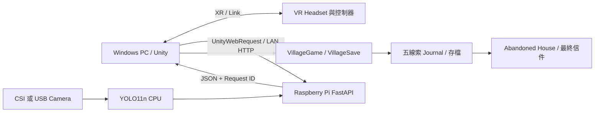

# Do You Remember V=IR? Raspberry Pi 建置與遊玩指南

這份指南對應本 Repository 的實際程式。先完成 Pi 本機相機測試，再測 API，最後進 Unity。
**軟體自動化測試已執行；未連接 Raspberry Pi／實體 Camera／VR 做本次硬體驗收。**
請不要把測試中的假相機結果當成真實 YOLO 成功。完整結果見 `Verification/recognition-validation.md`。

## 1. 專題系統架構

故事：玩家調查失蹤研究員，任意順序拜訪五間房屋。每間先完成遊戲，再取實物到 Pi 相機前辨識，領取一條線索。五條線索解鎖廢棄屋，最終信件揭露研究員就是玩家。



若使用 Quest 獨立 APK，HTTP 從頭盔發出，頭盔也必須與 Pi 同網段。
API 不會直接修改 Unity 進度；Unity 驗證請求 ID、房屋索引、物件、信心、影格數、時間格式與正式／模擬標記。
服務預設只綁 127.0.0.1，必須自行改成 Pi 的 LAN IP 才能從 Windows 連入。

## 2. 所需硬體與軟體

| 項目 | 本專案基準／用途 |
|---|---|
| Windows PC | 已有 Unity 專案；可跑 Editor、PC VR 或建置 Quest |
| Unity | `ProjectSettings/ProjectVersion.txt`：6000.0.80f1 |
| XR | XRI 3.1.3、OpenXR 1.16.1；依實際頭盔啟用 runtime |
| VR 頭盔 | 實際型號未知；本專案有 Quest／Android 設定 |
| Raspberry Pi | 建議 Pi 4／5，確切板型、記憶體未知；CPU 推論，不需 NVIDIA |
| 電源、microSD | 使用符合該 Pi 型號規格的電源，至少 32GB 卡，建議散熱器 |
| 相機 | 實際型號未知；CSI 使用 Picamera2，USB 使用 OpenCV |
| OS | 安裝腳本支援 Raspberry Pi OS Bookworm 64-bit / aarch64 |
| Python | Pi 基準 3.11；目前測試環境為 Linux x86_64 Python 3.12 |
| 套件 | FastAPI 0.115.12、Uvicorn 0.34.2、Pydantic 2.11.4、pydantic-settings 2.9.1 |
| 辨識 | Ultralytics 8.3.152、YOLO11n；Torch CPU；OpenCV 4.11.0.86、numpy<2 |
| 實物 | 鍵盤、筆電、滑鼠、手機、一般時鐘各一 |
| 網路 | PC／Pi／獨立頭盔同一可信任 LAN；避免訪客 Wi-Fi 隔離 |

此處選 Bookworm 是相機與 NumPy ABI 的明確基準。若 Imager 預設是其他版本，從其他 OS／Legacy 選單尋找 Bookworm 64-bit；找不到時使用 Raspberry Pi 官方歷史映像。不要把 32-bit 或其他版本硬套安裝腳本。其他 OS 尚未驗證，腳本會拒絕而非假裝相容。

官方依據：[相機軟體](https://www.raspberrypi.com/documentation/accessories/camera-software.html)、[Picamera2](https://github.com/raspberrypi/picamera2)、[Pi YOLO 部署](https://docs.ultralytics.com/guides/raspberry-pi/)。

## 3. Raspberry Pi OS 安裝

1. 在 Windows 安裝官方 Raspberry Pi Imager。
2. 插入 microSD。選擇正確 Pi 型號，選 Raspberry Pi OS Bookworm **64-bit**，Lite 可用。
3. 儲存裝置選 microSD，核對容量，寫入會清除此卡內容。
4. 自訂設定：主機名設 `raspberrypi` 或自訂名稱；建立自己的使用者（例如 `student`）與密碼。新版不保證存在 `pi` 使用者。
5. 設定 Wi-Fi SSID、密碼、國家 Taiwan、時區 Asia/Taipei；啟用 SSH，可先用密碼登入。
6. 寫入並完成驗證，安全退出卡片。Pi 斷電時插入卡與相機，再接電。首次開機等待約數分鐘。
7. 到路由器 DHCP 用戶清單找到該主機。沒有螢幕時，這通常比猜 IP 可靠。

## 4. Windows 如何連接 Raspberry Pi

以下每段命令前會標示執行位置。`PS C:\...>` 是 Windows；`student@raspberrypi:~ $` 是 SSH 後的 Pi Linux。提示字元本身不要貼上。

### PowerShell

在 **Windows PowerShell** 執行，用途為測試主機名稱；預期有回覆。若找不到名稱，從路由器取得 IP 後改用 IP；下一步 SSH。

```powershell
ping raspberrypi.local
```

在 **Windows PowerShell** 執行，用你在 Imager 設的使用者取代 student。用途為登入；第一次顯示 host fingerprint 時，核對這是你的 Pi 再輸入 yes；密碼輸入不顯示字元是正常的。成功後提示變成 Linux；Permission denied 請核對使用者與密碼，Connection refused 請確認 SSH 已啟用。

```powershell
ssh student@raspberrypi.local
```

如果名稱失效，在 **Windows PowerShell** 改以路由器查到的位址登入（下例 IP 必須換掉）；成功後繼續第 5 章。

```powershell
ssh student@192.168.1.50
```

在 **Pi SSH Terminal** 執行，依序查看目前使用者、路徑與 IP；預期是 student、/home/student、LAN 位址。若仍顯示 Windows，表示還未成功 SSH；確認後才執行 Linux 安裝命令。

```bash
whoami
pwd
hostname -I
```

### PuTTY

Windows 安裝 PuTTY → Session → Host Name 填 Pi IP → Port 22 → SSH → Open。
核對主機金鑰後接受；login as 填自建使用者，輸入密碼。成功後和 PowerShell SSH 是同一個 Linux 環境，以下命令相同。
若重灌 Pi 後主機金鑰改變，先確定連到正確設備，才清除舊記錄；不要忽略來源不明的金鑰變更。

## 5. Raspberry Pi 初始設定

在 **Pi SSH Terminal、任意目錄** 執行下列兩行。第一行更新套件清單；第二行完整升級，維持 libcamera／Picamera2 一致。預期無錯誤結束；若 DNS 或下載失敗先修復網路，再重跑。完成後重開機。

```bash
sudo apt update
sudo apt full-upgrade -y
```

在 **Pi SSH Terminal** 執行重新開機；SSH 斷線是預期結果。等 Pi 回來，以第 4 章方式重新登入；若無回應先檢查電源與路由器。

```bash
sudo reboot
```

在 **Pi SSH Terminal** 安裝 Git，預期完成。若找不到套件先跑 apt update。下一步下載專案。

```bash
sudo apt install -y git
```

先在 GitHub Repository 頁面按 Code 複製 HTTPS URL。**Pi SSH Terminal** 中逐行執行以下命令；將 URL 換成你的真實 Repository URL（不要原樣貼範例）。用途為下載 main 到家目錄，預期建立 AOOP_project。私人 repo 請用 GitHub 正規認證流程，勿把 token 塞入 URL 或提交檔案。下載成功後進入 Pi 子目錄。

```bash
cd ~
git clone --branch main https://github.com/YOUR_ACCOUNT/AOOP_project.git
cd ~/AOOP_project/raspberry_pi
```

在 **Pi 的 ~/AOOP_project/raspberry_pi** 執行。用途：檢查 Bookworm ARM64、安裝 apt 相機套件、建立繼承系統套件的 venv、安裝 API／YOLO、建立隨機 token。預期最後顯示 Installed。耗時取決網路；失敗不可往下假裝成功。`No matching distribution` 檢查是否 64-bit；相機 import 的 ABI 錯誤見 FAQ。

```bash
bash scripts/install.sh
```

在 **同一 Pi 目錄** 執行編輯設定；預期 nano 開啟 `.env`。將 SERVER_HOST 改為 `hostname -I` 顯示的 Pi LAN IPv4，例如 `192.168.1.50`，SERVER_PORT 保持 8765。Ctrl+O、Enter 儲存，Ctrl+X 離開。找不到 nano 可使用系統提供的文字編輯器。下一步下載模型。

```bash
nano .env
```

保留自動產生的 ACCESS_TOKEN。用編輯器複製它到 Unity 的 Access token，**不要放 Git 或截圖公開**。
不想從 LAN 存取時保留 127.0.0.1。IP 改變時要同時更新 `.env` 與 Unity URL，或在路由器設定 DHCP reservation。
安裝程式不使用 sudo pip，也不提供 mock 後端。

## 6. 相機連接與測試

### 接線

1. 關機並拔除電源才操作 CSI 排線。
2. Pi 4 與 Pi 5 相機插座尺寸不同；Pi 5 常需要對應的小型接頭排線。依相機／Pi 官方圖示核對接點方向，不憑線材顏色猜。
3. 輕拉卡扣、平直插到底、扣回，不折傷排線、不硬拉鏡頭模組。USB 相機插 USB 即可。
4. 通電後 CSI 用 Picamera2；USB 將 `.env` 的 CAMERA_BACKEND 改 opencv，CAMERA_INDEX 通常為 0。

在 **Pi SSH Terminal** 偵測 CSI。預期列出感測器；若 No cameras available，斷電檢查線材、方向、接頭與模組相容性。這步成功後拍照。

```bash
rpicam-hello --list-cameras
```

在 **Pi SSH Terminal** 拍攝到家目錄，`--nopreview` 適合無螢幕 SSH。預期產生 camera-check.jpg；Device busy 表示其他服務佔用，先依第 8 章停服務。下一步測 Python 相機路徑。

```bash
rpicam-still --nopreview -o ~/camera-check.jpg
```

在 **Pi 的 raspberry_pi 目錄** 執行。正式服務必須停止；預期 `PASS: real camera captured` 並產生 camera-test.jpg。若相機初始化失敗，先檢查 CAMERA_BACKEND 與接線。成功後在桌面開圖或複製回 Windows 確認顏色、對焦與曝光。

```bash
bash scripts/check_camera.sh
```

在 **Windows PowerShell** 執行，取回相片（使用者與 IP 改成你的）。預期下載到當前 Windows 目錄；找不到檔案時核對 Pi 路徑。開啟照片確認後進行模型測試。

```powershell
scp student@192.168.1.50:~/AOOP_project/raspberry_pi/camera-test.jpg .
```

不要同時開 rpicam、camera_test 和 recognition.service。服務只有一個相機擁有者；USB 驅動不支援多開時一樣會失敗。

## 7. YOLO 安裝與辨識測試

在 **Pi 的 raspberry_pi 目錄** 執行明確下載。預期 models/yolo11n.pt、類別表與本機 SHA256 記錄。若網路失敗可重試；不要下載來源不明的權重。成功後跑環境檢查。

```bash
bash scripts/download_model.sh
```

在 **同一 Pi 目錄** 執行；預期顯示 ARM64、Bookworm、Python、依賴版本與五類檢查 PASS。若 pip check 有衝突先解決再啟動；缺類請看 models/README.md 的模型替換流程。

```bash
bash scripts/check_environment.sh
```

COCO 官方類別支援 keyboard、laptop、mouse、cell phone、clock；phone 會正規化成 cell phone。
這只是類別支援，並不代表你的每個物件都已實測辨識成功。clock 建議先用大而清楚的傳統時鐘，手錶或特殊數位顯示器不保證等價。

在 **Pi 的 raspberry_pi 目錄** 執行，對剛拍的真實照片進行 YOLO CPU 推論。預期如 `[["keyboard", 0.89]]`；`[]` 是沒有達門檻，不是成功。改善燈光、物件大小與對焦，重新拍照再測；依次測五個物件後啟動 API。

```bash
.venv/bin/python -m app.image_test camera-test.jpg
```

建議每次只展示一個物件，占畫面中間約 1/3～2/3，避免反光與遮擋。手機螢幕不用顯示私密資訊。
預設 `.70` 信心、3 連續影格、45 秒辨識上限。CONFIDENCE_THRESHOLD 最低 .70、REQUIRED_STABLE_FRAMES 最低 3，不能降到 Unity 驗證要求以下。
INFERENCE_SIZE 可選 320／416／640 等 32 倍數；Pi 4 可先 320。較低解析度速度快但小物件可能漏檢。
CPU_THREADS 預設 2，無需 CUDA。原生讀圖／推論卡住時父程序會終止工作，服務轉 degraded，排除原因後 restart。

自訂模型的資料收集、訓練、驗證與替換流程在 `raspberry_pi/models/README.md`，不會用假結果補不支援的類別。

## 8. 啟動 Raspberry Pi API Server

在 **Pi 的 raspberry_pi 目錄** 手動啟動。預期 Uvicorn 顯示指定 host:8765，首次載模型可能需等待 90 秒。Token 未設定或仍 CHANGE 開頭會拒絕啟動；camera/model 出錯時 health 會 degraded。保持此 SSH 視窗開啟，另開一個 SSH 視窗測 health。

```bash
bash scripts/start_server.sh
```

開發模式是在 **同一目錄** 使用以下替代命令，提供 debug logs；先 Ctrl+C 停止前一服務。預期同一 API，多一些 log。沒有 auto-reload，避免雙開相機；下一步測 health。

```bash
bash scripts/start_server.sh --dev
```

在 **另一個 Pi SSH Terminal 的 raspberry_pi 目錄** 執行。用途為帶入本機 token 測健康；預期 ready、camera、model 為 true。Connection refused 檢查啟動視窗，ready=false 看 message。通過後再測 Windows。

```bash
bash scripts/health.sh
```

### systemd 正式啟動

先在手動服務視窗 Ctrl+C。以 **一般 Pi 使用者、raspberry_pi 目錄** 執行（不要整條 sudo）。腳本將實際使用者與路徑填進 service、啟用開機自動啟動。預期 active (running)；工作路徑不能含空白，失敗看日誌。下一步再次 health。

```bash
bash scripts/install_service.sh
```

以下都在 **Pi SSH Terminal**，依需要使用，不必全部連續執行：

| 命令 | 用途／預期 | 錯誤與下一步 |
|---|---|---|
| `systemctl status recognition --no-pager` | 顯示服務狀態，預期 active | failed 時看 journal；active 不等於 camera ready |
| `journalctl -u recognition -n 100 --no-pager` | 最近 100 行 log | 無權限可加 sudo；讀 message 排除相機或模型錯誤 |
| `journalctl -u recognition -f` | 即時追蹤 | Ctrl+C 只離開查看，不會停服務 |
| `sudo systemctl stop recognition` | 停止並釋放相機 | 完成後才能跑 camera_test |
| `sudo systemctl restart recognition` | 改設定／修硬體後重新啟動 | 再用 health 確認 ready |
| `sudo systemctl disable --now recognition` | 取消開機啟動並停止 | 日後需要時重跑 install_service.sh |

服務只開一個 Uvicorn worker。不可自行加 `--workers 2`。
不要設定路由器 port forwarding，不要用公網 IP。若已有防火牆，只允許 PC／頭盔實際 LAN IP 對 Pi 的 TCP 8765；保留 SSH 22，避免把自己鎖在外面。

## 9. Windows 測試 API

在 **Windows PowerShell** 逐行執行。前兩行設定 URL 與讀入 token（本次 console 的記憶體變數，關閉視窗即失效），第三行設定 header，第四行 GET health。預期 protocol=1 且 ready=true。401 是 token 不同、拒絕連線是服務／綁定錯誤、逾時是路由或防火牆；修好後再 POST。

```powershell
$piUrl = 'http://192.168.1.50:8765'
$cameraToken = Read-Host '貼上 Pi .env 的 ACCESS_TOKEN'
$headers = @{ 'X-FV-Token' = $cameraToken }
Invoke-RestMethod -Uri "$piUrl/health" -Headers $headers -TimeoutSec 5
```

下列在 **同一 PowerShell 視窗**。依序產生 32 字元 ID、建立 JSON、送出 Elder 的 keyboard 辨識。預期 HTTP 202 與 pending 或已完成結果；422 檢查房屋物件對照，429 等前一工作結束。成功送出後把鍵盤放到相機前，再查結果。

```powershell
$requestId = [guid]::NewGuid().ToString('N')
$body = @{ request_id=$requestId; house_id='elder'; expected_object='keyboard' } | ConvertTo-Json
Invoke-RestMethod -Method Post -Uri "$piUrl/verify" -Headers $headers -ContentType 'application/json' -Body $body -TimeoutSec 5
```

在 **同一 PowerShell 視窗** 查詢，可隔一秒重複。預期 pending 最終變 success／failed／timeout／camera_error／model_error。404 代表 ID 錯、服務重啟或超過 600 秒，重建請求；只有 success 才代表這次相機確認成功，仍不會直接改 Unity 進度。

```powershell
Invoke-RestMethod -Uri "$piUrl/verify/$requestId" -Headers $headers -TimeoutSec 5
```

成功回應範例（示意，非本次實物實測）：

```json
{"requestId":"0123456789abcdef0123456789abcdef","questIndex":0,"status":"success","objectName":"keyboard","confidence":0.88,"frames":3,"snapshot":"0123456789abcdef0123456789abcdef.jpg","capturedUtc":"2026-11-25T09:00:00+00:00","simulated":false,"message":"Stable camera observation verified"}
```

若偏好 curl，在 **同一 PowerShell 視窗** 執行下列 health 測試；要用 `curl.exe`，避免 Windows PowerShell 的 curl alias。預期同樣 JSON；失敗按前面的 HTTP／網路分類排除，成功再進 Unity。

```powershell
curl.exe --max-time 5 -H "X-FV-Token: $cameraToken" "$piUrl/health"
```

完整欄位、TTL、重試、狀態表在 `raspberry_pi/API.md`。POST 同 ID 重送不會開第二筆工作；不要把 expected_object 改成別類來繞過房屋。

## 10. Unity 連接 Raspberry Pi

1. Unity Hub → Add project → 本機 `C:\Github_rep\AOOP_project`（你的 clone 位置不同就用實際位置），以 6000.0.80f1 開啟。
2. 開 `Assets/Scenes/rpgpp_lt_scene_1.0.unity`，這是 Build Settings 第一個啟用場景。不是直接 Play 房屋或素材 Demo 場景。
3. Hierarchy 找 **The Forgotten Village — Systems**，Component **Object Recognition Client**（C# ObjectRecognitionClient）。已在場景掛好，不需要新建另一個 GameManager。
4. Inspector 的 **Endpoint** 填 `http://你的PiIP:8765`；Port 包含在 URL，沒有獨立的 Port 欄位。**Access Token** 請在遊戲執行期間填，或用遊戲 UI；不要將真實 token 存入場景並提交。
5. **Request Timeout** 預設 5 秒，**Verification Timeout** 預設 120 秒，**Mock Outcome** 只供模擬。每次啟動強制 Live，舊場景的 simulation 值不會悄悄啟用 Mock。
6. Play → Settings → Camera settings：實際可輸入欄位名稱是 **Camera URL**、**Access token**；按 **Apply connection** 套用。
7. 再進 Camera settings 按 **Test connection**。畫面 Toast 應出現 `LIVE connection passed: camera and model ready`。若無成功，先照第 9 章從 Windows 測試。
8. 可選環境變數 FV_CAMERA_URL、FV_CAMERA_TOKEN；必須在啟動 Unity 前設定才會被讀取。Quest 不繼承 PC 環境變數，使用遊戲內欄位。

實際程式在 `Assets/TheForgottenVillage/Scripts/Hardware/`。`VillageGame` 在舊參考場景沒掛 Client 時也會自動補，但推薦使用已掛好的正式啟動場景。
Unity Player 設定已允許 HTTP（包含發行建置），目的是這個 LAN API。這不會自動開路由器埠，仍必須只在可信任網路使用；需要加密時改 HTTPS endpoint。

## 11. VR 遊戲啟動

先確認 Desktop Play 能顯示主選單、滑鼠與鍵盤可操作，再做頭盔設定。
PC VR：連接頭盔及控制器、啟動該裝置 OpenXR runtime／Link，Unity XR Plug-in Management 選正確平台的 loader，再 Play。
Quest APK：安裝 Unity Android Build Support，切換 Android，Build Settings 保留村莊＋六房屋，接 USB、允許偵錯、Build And Run。此步需本機實際裝置驗證；不能因 C# 編譯成功就保證 APK 可玩。

Desktop：WASD 移動、滑鼠看、E 互動、J Journal、I inventory、Esc 暫停。
VR：用控制器移動、轉向、射線選取；站定再脫頭盔，把物件拿到固定相機前，回到原遊玩位置再戴回。
Unity 已設 Application.runInBackground=true，但頭盔作業系統仍可能暫停 app；若回來顯示逾時，重新驗證即可，不會重複領取線索。
開始遊戲先和村莊 Elder 完成介紹；這是全局故事啟動，不限制後續五屋順序。

## 12. 五間房屋完整流程

每間的共通步驟：完成小遊戲 → 聽 NPC 恢復記憶 → 打開 Journal 的 Object quest（或居民的 Investigate record）→ Start verification → 展示實物 → 等 Camera verified → **Collect clue** → Journal 顯示已取得 → 走出口返回村莊。
成功掃描先保存物件證據，不會自動跳過 Collect clue。相同物件或同線索重複掃描不會增加另一條線索。
現有額外敘事條件仍保留：Elder 檢視照片、Alchemist 檢視夢境紀錄；另外三屋完成恢復記憶對話。

| 房屋／場景 | 玩家動作與通關 | 真實物件／線索 |
|---|---|---|
| Elder / EldersHouse | 控制球拍回擊，贏得三戰兩勝，聽恢復記憶對話並檢視解鎖照片；照片頁可按 Verify keyboard | 鍵盤完整平放於相機前；clue_1：The Forgotten Person / Scratched Photograph |
| Alchemist / AlchemistsHouse | 飛機避障生存 60 有效秒；可用控制器模式（左搖桿與升降）或現有身體追蹤模式；結束夢境後對話並檢視紀錄 | 打開筆電讓螢幕與鍵盤都清楚可見；clue_2：Memory Signal Filtering Record |
| Carpenter / CarpentersHouse | Quick Hands 60 秒達 900 分；打發光標靶、0.4 秒內雙手配對、躲避工具，完成恢復記憶 | 滑鼠放亮色或對比背景，別被手蓋住；clue_3：**Analog Front-End Records** |
| Technician / TechniciansHouse | Planetary Defence：瞄準／Select 20 艘敵艦，5 HP 至少剩 1；完成 NPC 記憶對話 | 手機占足夠畫面，減少反光；clue_4：Safety Controller Software Record |
| Clockmaker / ClockmakersHouse | Rhythm Repair：六鐘兩排，48 音至少 34 命中、最多 12 額外敲擊；命中黃金標記並完成對話 | 清楚錶面的時鐘；clue_5：Timing Analysis Record |

在相機前先拿開其他類似物件，保持目標穩定數秒；每秒速度依 Pi 與模型而異，三影格不是固定三秒。
failed 表示看到不符物件，timeout 常是沒看見、信心不足或動得太快；任何失敗都不發線索。
若 Camera verified 但不能領取，先完成該屋的 NPC 記憶／照片／紀錄敘事條件，再返回 Collect clue。
Journal/Tracker 應顯示 Objects x/5、Clues x/5，切換 additive Scene 或存檔後 Continue 不應遺失。

## 13. 第六間房屋

`AbandonedHouse.unity` 已存在並列在 Build Settings。必須五個不同索引的線索與各自有效證據全部成立才能進入；只把 clues 設成 true 仍不能通過檢查。
村莊的入口與 HouseTransitions 都檢查解鎖。掃同一物件五次不會解鎖。
進屋後依現有四個調查點閱讀線索，重現 faulty／fixed controller diagnostics，最後開啟 archive chest。
最終畫面新增具體信件文字：「若我忘記，就沿五份紀錄回到這裡。我建造了 Memory Interface Controller。我就是失蹤的研究員。」
實體 Arduino 門閂是既有附加功能，與 Pi Camera 分開；其硬體也未在本次驗證。Mock 不可開啟實體門閂。

## 14. Mock Mode（沒有 Pi 時）

只在村莊／主選單切模式，房屋內會要求先返回村莊。Settings → Camera settings → **Simulation / Live**。
進入 MOCK 後會載入獨立測試存檔，再按 Start Game 或 Continue。Mock **仍必須實際完成遊戲**，沒有正式模式跳關按鈕。
完成房屋後 Object quest → Start verification → **Mock outcome** 逐次切換 → Simulate detection。

| outcome | 行為 |
|---|---|
| Success | 使用本屋物件，因此五屋分別模擬五種成功 |
| WrongObject | 不符類別，不能領線索 |
| NoObject | failed |
| LowConfidence | .20，Unity 拒收 |
| Timeout | timeout |
| ServerError | model_error |

畫面與證據標記為 MOCK／SIMULATED。重啟遊戲預設 Live，不自動使用模擬。
正式存檔 `forgotten-village-v1.json`，模擬 `forgotten-village-mock-v1.json`，都在 Unity Application.persistentDataPath，各有 .bak 備份。
舊版本前兩屋沒做實物驗證的線索會撤回，但已完成遊戲保留；重新掃鍵盤／筆電領取，不會憑空製造相機證據。

## 15. 常見問題

| 問題 | 排除步驟 |
|---|---|
| SSH 無法登入 | 先核對 Imager 的使用者，不預設 pi；再確認 SSH 啟用、密碼、Port 22；拒絕連線與密碼錯誤是不同問題 |
| Wi-Fi 找不到 Pi | 路由器 DHCP 清單查名稱；確認 SSID／頻段與國家設定；避免訪客網路；可先用網線 |
| IP 改變 | 用 hostname -I 查，更新 Pi SERVER_HOST＋Unity endpoint，再 restart；推薦 DHCP reservation |
| Camera 無法啟動 | 關閉服務再測 rpicam；斷電重插正確排線；確認 Pi 5 接頭；USB 選 opencv |
| Device busy | rpicam、其他 Python 或 recognition 已佔相機；只保留一個，服務不支援多 worker |
| Python 套件安裝失敗 | 檢查 Bookworm 64-bit、可用磁碟、網路；使用 .venv，不用 sudo pip；NumPy ABI 錯誤確認 numpy<2 與 apt 套件版本一致 |
| YOLO 模型無法載入 | 檢查 MODEL_PATH 以 raspberry_pi 為相對基準；執行 inspect_model；缺檔重跑下載，缺類重新選模型 |
| YOLO 找不到物件 | 先 camera_test 看真實圖，再 image_test；改善照明、距離、遮擋；不要把 threshold 降到 .70 以下 |
| Clock 辨識失敗 | 確認模型 names 真有 clock；用清晰一般時鐘，避開小手錶／強反光；收集實例做自訂訓練 |
| Unity 無法連線 | 先 Windows health；Quest 獨立版另確認頭盔與 Pi 同 LAN，PC 通不代表 Quest 通 |
| Connection Refused | 服務未啟動、綁 localhost、port 錯、IP 改變；用 service status 和 Pi health 查 |
| Timeout | 網路阻擋與推論過慢分開查；image_test 慢可用 320px；原生呼叫卡住後 restart |
| HTTP 401 | Access token 不相同；遊戲 token 僅留當次 session |
| HTTP 429 | 正有另一工作或結果 cache 已滿；等工作完成／TTL 到期，不要連點 Start |
| HTTP 503 | 看 health message；修相機／模型後 restart |
| JSON 錯誤 | 確認 URL 指向本服務而非其他網頁；不要沿用舊 /v1/quests；看 API.md |
| 線索沒有取得 | 完成遊戲、恢復記憶、前兩屋檢視紀錄，再辨識且按 Collect clue；wrong／timeout 不會發獎 |
| 重複取得線索 | 同索引應只記一次；保存問題看 Unity Console；不要手動改 JSON，保留 .bak 供診斷 |
| 第六屋未解鎖 | 必須五條有效不同線索，正式／Mock 不混用，舊照片線索需補掃描 |
| health 顯示 ready 卻後來拔相機 | health 是最近已知狀態；下一次真正讀圖才偵測硬體拔除，失敗會 degraded |
| Ctrl+C 很慢 | 正在辨識時會等待有界工作結束；systemd 最多等待 110 秒，避免殘留相機程序 |

## 16. 測試、資料與維護

在 **Pi 的 raspberry_pi 目錄** 安裝測試依賴；預期安裝 pytest／httpx，失敗先排除網路。完成後執行測試。

```bash
.venv/bin/python -m pip install -r requirements-dev.txt
```

在 **同目錄** 執行軟體測試；預期全通過。測試使用隔離假相機，不需硬體，失敗請保留輸出；通過後仍要照第 17 章做實物驗收。

```bash
bash scripts/test.sh
```

Unity：Tools → Forgotten Village → Run recognition and progress tests。結果寫入 `Verification/recognition-editmode.xml` 與 `.txt`。此項含遊戲規則與存檔測試，不等於頭盔實機測試。
成功相片在 Pi evidence/，不要放 Git、公開分享或無限保存。在 **Pi 的 raspberry_pi 目錄** 用下列命令預覽七天前將清理的檔案；預期只列檔名，無檔則無輸出；確認無需保留後下一步刪除。

```bash
bash scripts/cleanup_evidence.sh
```

在 **同目錄** 使用以下命令才會實際刪除七天前的服務 JPEG；預期列 delete，若權限不足先確認是服務使用者，不要任意 sudo 刪整個目錄。這不會刪 Unity 進度，完成後可繼續服務。

```bash
bash scripts/cleanup_evidence.sh --delete
```

更新程式前先停止服務，在 **Pi 的 repository 根目錄** 執行下列命令。用途為只接受可快轉 main 更新；預期無衝突。若本地有修改先保存，不用 reset --hard。成功後進 raspberry_pi、重跑 install.sh 更新依賴並 restart。

```bash
cd ~/AOOP_project
git pull --ff-only origin main
```

## 17. 已驗證與尚未驗證項目

精確數字與執行結果：`Verification/recognition-validation.md`。本指南不把「程式存在」當成「硬體通過」。

| 層級 | 驗證範圍 |
|---|---|
| Python 自動化 | 類別映射、信心／影格、五物件、API 授權／去重／忙碌／故障／TTL、相機生命週期替身、硬逾時替身 |
| Unity 編譯／EditMode | 現有遊戲規則、五物件證據、Mock 隔離、存檔與最終解鎖；結果檔可查 |
| 未實測 | Pi OS 安裝實機、ARM64 套件安裝、CSI／USB 相機、YOLO 五實物準確率、Wi-Fi、systemd 開機 |
| 未實測 | Quest／PC VR 完整五屋流程、頭盔脫戴後輪詢、Android HTTP 實際連線、實體門閂 |

硬體驗收請逐項記錄日期、Pi／Camera 型號、模型 SHA、版本與結果：

- 每物件展示 10 次，記成功次數、平均耗時；錯誤物件各 5 次不可發錯線索。
- 無物件、低光、遮擋、拔相機、關服務，確認 UI 錯誤且無線索。
- 尚未完成遊戲不能開始；相同線索領兩次仍 x/5 不增加。
- 每取得一條返回村莊、存檔、重開 Continue 確認保留。
- 四條時第六屋鎖定；五條時可進；Mock 進度不能污染 Live。
- 系統重開機後 health ready；Windows 與實際頭盔均能連線。

## 18. 課堂 Demo 快速啟動（一頁）

前提：完整安裝、五種實物與硬體驗收均已完成；不要到課堂才第一次下載模型。

1. Pi 與 PC／頭盔接同一 LAN，Pi 接電、相機固定、照明充足，放好五物件。
2. **Pi SSH**：`hostname -I` 查 IP；預期你的 LAN 位址，若改變先更新 `.env` 與 Unity，再下一步。
3. **Pi SSH**：`sudo systemctl restart recognition` 啟動；預期無錯誤，失敗查 journal，成功後下一步。
4. **Pi raspberry_pi 目錄**：`bash scripts/health.sh`；必須 ready=true，否則修相機／模型，不進 Demo。
5. Windows 開 Unity 6000.0.80f1 → `Assets/Scenes/rpgpp_lt_scene_1.0.unity` → Play。
6. Settings → Camera settings → Camera URL、Access token → Apply connection → Test connection，看到 LIVE passed。
7. Start Game → 與 Elder 介紹 → 進任一屋完成遊戲／記憶／紀錄 → Start verification。
8. 拿下頭盔，展示該屋實物，戴回後確認 Camera verified → Collect clue → 返回村莊。
9. 重複五屋，Objects 5/5、Clues 5/5 → Abandoned House → 調查與最終信件。
10. 若現場硬體無法排除，返回村莊明確切 **MOCK MODE** 使用獨立測試存檔，對觀眾說明是模擬；不得宣稱 YOLO 實測成功。
