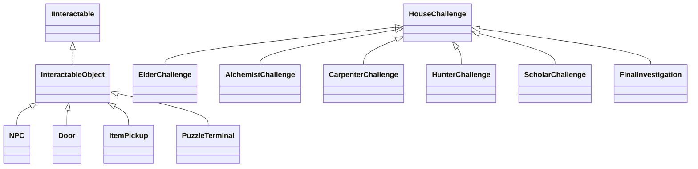
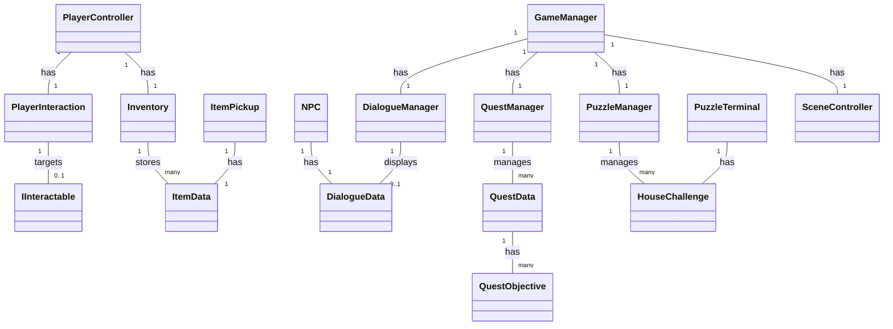

# The Forgotten Village — Class Diagrams

> Proposed Unity C# class architecture based on `team_division.md`. Class names and methods below are a design proposal, not a claim that these scripts already exist. The five clue houses and the final abandoned house are represented as separate `HouseChallenge` subclasses.

## Overview

## Has-A Relationship

## Detail

```mermaid
classDiagram
    class IInteractable {
        <<interface>>
        +Interact(): void
    }

    class InteractableObject {
        <<abstract>>
        #interactionPrompt: string
        +Interact(): void
        +GetInteractionPrompt(): string
    }

    class NPC {
        -dialogueData: DialogueData
        -questId: string
        +Interact(): void
        +GetDialogue(): DialogueData
    }

    class Door {
        -destinationScene: string
        -isLocked: bool
        +Interact(): void
        +Unlock(): void
    }

    class ItemPickup {
        -itemData: ItemData
        +Interact(): void
        +GetItemData(): ItemData
    }

    class PuzzleTerminal {
        -challenge: HouseChallenge
        +Interact(): void
        +OpenChallenge(): void
    }

    class HouseChallenge {
        <<abstract>>
        #challengeId: string
        #isCompleted: bool
        +StartChallenge(): void
        +Validate(): bool
        +CompleteChallenge(): void
        +IsCompleted(): bool
    }

    class ElderChallenge {
        +Validate(): bool
    }

    class AlchemistChallenge {
        +Validate(): bool
    }

    class CarpenterChallenge {
        +Validate(): bool
    }

    class HunterChallenge {
        +Validate(): bool
    }

    class ScholarChallenge {
        +Validate(): bool
    }

    class FinalInvestigation {
        +Validate(): bool
    }

    class PlayerController {
        -moveSpeed: float
        -body: Rigidbody
        -interaction: PlayerInteraction
        +Move(direction: Vector2): void
        +Interact(): void
    }

    class PlayerInteraction {
        -interactionRange: float
        -currentTarget: IInteractable
        +FindTarget(): IInteractable
        +TryInteract(): void
    }

    class ItemData {
        -itemId: string
        -displayName: string
        -description: string
        +GetId(): string
    }

    class Inventory {
        -items: List~ItemData~
        +AddItem(item: ItemData): bool
        +HasItem(itemId: string): bool
        +GetItems(): List~ItemData~
    }

    class DialogueData {
        -dialogueId: string
        -lines: List~string~
        +GetLine(index: int): string
    }

    class DialogueManager {
        -currentDialogue: DialogueData
        -currentLineIndex: int
        +StartDialogue(data: DialogueData): void
        +NextLine(): void
        +EndDialogue(): void
    }

    class QuestObjective {
        -objectiveId: string
        -requiredCount: int
        -currentCount: int
        +Advance(amount: int): void
        +IsComplete(): bool
    }

    class QuestData {
        -questId: string
        -objectives: List~QuestObjective~
        +IsComplete(): bool
    }

    class QuestManager {
        -activeQuests: List~QuestData~
        +StartQuest(questId: string): void
        +UpdateObjective(objectiveId: string): void
        +IsQuestComplete(questId: string): bool
    }

    class PuzzleManager {
        -challenges: List~HouseChallenge~
        +StartChallenge(challengeId: string): void
        +CompleteChallenge(challengeId: string): void
        +AreFiveCluesComplete(): bool
    }

    class SceneController {
        -finalHouseUnlocked: bool
        +LoadScene(sceneName: string): void
        +UnlockFinalHouse(): void
    }

    class GameManager {
        -currentState: GameState
        +StartGame(): void
        +CheckFinalHouseUnlock(): bool
        +CheckEnding(): bool
    }

    IInteractable <|.. InteractableObject
    InteractableObject <|-- NPC
    InteractableObject <|-- Door
    InteractableObject <|-- ItemPickup
    InteractableObject <|-- PuzzleTerminal

    HouseChallenge <|-- ElderChallenge
    HouseChallenge <|-- AlchemistChallenge
    HouseChallenge <|-- CarpenterChallenge
    HouseChallenge <|-- HunterChallenge
    HouseChallenge <|-- ScholarChallenge
    HouseChallenge <|-- FinalInvestigation
```

---

**Team ownership:** Jane — `PlayerController`, `PlayerInteraction`, `IInteractable`, `Inventory`, item and door interaction, Elder/Carpenter/Scholar houses. Jemmy — `NPC`, `DialogueManager`, `QuestManager`, dialogue/quest data, Alchemist/Hunter/Final houses. Shared — `GameManager`, integration, final testing. `PuzzleManager` and the common `HouseChallenge` contract require joint integration.

**UML note:** In the Has-A diagram, `--` indicates association/reference, not necessarily composition or lifecycle ownership. In the Detail diagram: `+` public, `-` private, `#` protected. The design intentionally omits optional Arduino/VR classes because the current team division defines the core Unity RPG tasks.

**Sources:**
- Class diagram format: https://github.com/ARG-NCTU/oop-python-nycu/blob/main/docs/oop_lec9_class_diagrams/team_ta_pyivp.md
- Current team division: https://github.com/Chengjane0821/AOOP_project/blob/main/team_division.md
